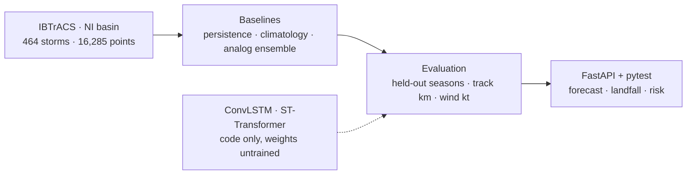

# Rishi Gupta

<a href="https://github.com/cellrishi-code"></a>

**I turn mathematics (ODEs, statistics, neural nets) into software that runs.**

**B.Tech, Mathematics & Computing at NIT Warangal (class of 2029)** &nbsp;·&nbsp; Founder of CloudAxis Labs and Lumex AI

<a href="https://www.linkedin.com/in/rishi-gupta-85bab0232/"></a>
<a href="mailto:cellrishi@gmail.com"></a>
<a href="mailto:cloudaxislabs@gmail.com"></a>

---

## About

I'm a mathematics-first engineer. The moment I like best is when an equation becomes something I can run, plot, and be wrong about. Most of my work sits between three things: **machine learning built from first principles**, **numerical simulation of physical systems**, and **the software that packages them**.

> **How I work: measure first, claim second.** My cyclone-forecasting lab publishes its baseline errors, including the cases where the fancier method loses, and labels every untrained model as untrained.

## What I'm building

| Focus | What's in the repos |
| :-- | :-- |
| **Machine learning** | Unsupervised methods, CNN/RNN/LSTM/GAN notebooks in PyTorch and Keras, a transformer study. See [Unsupervised-learning](https://github.com/cellrishi-code/Unsupervised-learning), [pytorch_basic-](https://github.com/cellrishi-code/pytorch_basic-), [keras----code-demo](https://github.com/cellrishi-code/keras----code-demo), [GANs-and-AutoEnocders](https://github.com/cellrishi-code/GANs-and-AutoEnocders) |
| **Applied ML systems** | A cyclone forecasting lab with a FastAPI backend, a data pipeline and tests: [SIH-FINAL-PROJECT-70](https://github.com/cellrishi-code/SIH-FINAL-PROJECT-70) |
| **Scientific computing** | Neuron, calcium and quantum wave-packet simulations in MATLAB and SciPy: [3D-Biology-model](https://github.com/cellrishi-code/3D-Biology-model), [Atom--MATLAB](https://github.com/cellrishi-code/Atom--MATLAB), [cubesat](https://github.com/cellrishi-code/cubesat) |
| **Algorithms** | Dynamic programming in C++, NeetCode submissions in Python: [DP-workshop](https://github.com/cellrishi-code/DP-workshop), [neetcode-submissions](https://github.com/cellrishi-code/neetcode-submissions) |
| **Products** | React/TypeScript and Express apps for students: [study-tracker](https://github.com/cellrishi-code/study-tracker), [Saarthi](https://github.com/cellrishi-code/Saarthi) |

## Tech stack

Only what my repositories actually use.

| | |
| :-- | :-- |
| **Machine learning** |      |
| **Scientific computing** |      |
| **Backend & web** |       |
| **Algorithms & workflow** |     |

## Featured projects

### 01 &nbsp; Indian Cyclone AI Weather Lab
*Before training a neural network: how good is a forecast that just extends the storm's last motion? Build honest baselines for North Indian Ocean cyclones, then measure them.*


*Solid arrows are implemented and measured. The dashed one is defined but not yet trained.*

- Builds an **Indian Cyclone Dataset** from NOAA IBTrACS v04r01: 464 storms and 16,285 track points, cropped to 0–30°N / 50–110°E, with IMD intensity classes.
- Runs **persistence, motion-climatology and analog-ensemble** forecasts and scores them on held-out data (track error in km, intensity error in knots).
- Serves forecasts, landfall and risk estimates through **FastAPI**, with a pytest suite.
- **Why it's interesting:** it refuses to fake progress. At 24 h the analog ensemble currently trails plain persistence (about 174 km vs 168 km mean track error), and the repo says so. Training the ConvLSTM and spatiotemporal-transformer models is gated on aligning ERA5, satellite and SST fields first.

`Python` `FastAPI` `NumPy` `pandas` `pytest` `PyTorch (model code)`

**[Repository](https://github.com/cellrishi-code/SIH-FINAL-PROJECT-70)** &nbsp;·&nbsp; [Architecture notes](https://github.com/cellrishi-code/SIH-FINAL-PROJECT-70/blob/main/docs/ARCHITECTURE.md) &nbsp;·&nbsp; [Datasets](https://github.com/cellrishi-code/SIH-FINAL-PROJECT-70/blob/main/docs/DATASETS.md)

---

### 02 &nbsp; Multiscale Cell-Signalling Simulation
*What do a neuron's electrical spikes and a tissue's calcium waves look like side by side? Put the classic models into one MATLAB framework and plot them.*

- Combines **Hodgkin–Huxley** action-potential dynamics, the **Li–Rinzel** calcium-oscillation model, and receptor–ligand binding kinetics.
- Adds a **40×40 grid** of diffusing calcium waves and a **1D axon cable** with full Hodgkin–Huxley dynamics.
- Plots phase-space trajectories, a conductance torus and a receptor-occupancy landscape in 2D and 3D.
- **Companion:** [Atom--MATLAB](https://github.com/cellrishi-code/Atom--MATLAB) verifies the Heisenberg uncertainty relation numerically with Gaussian wave packets and FFTs.

`MATLAB` `ODEs` `PDE diffusion` `FFT`

**[Repository](https://github.com/cellrishi-code/3D-Biology-model)** &nbsp;·&nbsp; [Uncertainty-principle simulation](https://github.com/cellrishi-code/Atom--MATLAB)

---

### 03 &nbsp; Machine-learning lab notebooks
*The same ideas, rebuilt in scikit-learn, PyTorch and Keras until they stop feeling like magic.*

- **[Unsupervised-learning](https://github.com/cellrishi-code/Unsupervised-learning):** k-means, hierarchical clustering, DBSCAN, PCA on MNIST, ICA, t-SNE, UMAP.
- **[pytorch_basic-](https://github.com/cellrishi-code/pytorch_basic-):** ANN and CNN on Fashion-MNIST (including GPU-optimised variants), an LSTM next-word predictor, an RNN question-answering model, autograd and training pipelines.
- **[keras----code-demo](https://github.com/cellrishi-code/keras----code-demo):** LeNet, ResNet, the functional API, hyperparameter tuning.
- **[GANs-and-AutoEnocders](https://github.com/cellrishi-code/GANs-and-AutoEnocders):** a GAN on CIFAR-10.

`PyTorch` `Keras` `scikit-learn` `Jupyter`

---

### 04 &nbsp; Engineering Study Tracker
*A single dashboard for an engineering student's semesters, subjects, streaks and focus time.*

- Semesters, subjects with credits, and per-topic progress.
- Daily study goals, streak tracking and a built-in Pomodoro timer with custom work and break lengths.
- A formula manager for storing formulas by subject.

`React` `TypeScript`

**[Repository](https://github.com/cellrishi-code/study-tracker)**

<details>
<summary><b>More builds</b></summary>

<br>

- **[Saarthi](https://github.com/cellrishi-code/Saarthi):** Express + EJS resource portal for NIT students, organised by department, semester and course.
- **[netflix-clone-app](https://github.com/cellrishi-code/netflix-clone-app):** a Netflix-inspired streaming UI in React and TypeScript.
- **[Blockchain-bluiding-from-scratch](https://github.com/cellrishi-code/Blockchain-bluiding-from-scratch):** SHA-256 hash-linked blocks in Python.
- **[cubesat](https://github.com/cellrishi-code/cubesat):** orbital-period calculations for a satellite with SciPy constants.

</details>

## Research & engineering questions

Experiments and open questions, not publications.

1. **Can a smarter analog selection beat persistence for cyclone tracks?** The current analog ensemble doesn't. The next step is aligning ERA5, INSAT and SST fields to storm-centred 64×64 grids, which the repo requires before any neural training.
2. **How much of the transformer can I rebuild from scratch?** I'm working through the 2017 architecture in PyTorch, alongside BERT tokenisation experiments: [transfomer_pytorch](https://github.com/cellrishi-code/transfomer_pytorch).
3. **Longer-term reading:** post-quantum cryptography and blockchain.

## Problem solving

Practice, kept in the open:

- **[neetcode-submissions](https://github.com/cellrishi-code/neetcode-submissions):** solutions synced from NeetCode.io (Python).
- **[DP-workshop](https://github.com/cellrishi-code/DP-workshop):** N-Queens and dynamic-programming templates (C++).
- **[DSA_in_Python](https://github.com/cellrishi-code/DSA_in_Python):** data structures and algorithms notes in Python.

## Currently exploring

```text
Currently exploring
├── Unsupervised learning ...... clustering and dimensionality reduction, end to end
├── Transformers ............... the 2017 architecture, in PyTorch
├── Cyclone forecasting ........ honest baselines, then neural models
├── Dynamic programming ........ patterns and templates in C++
└── LLM / RAG evaluation ....... DeepEval
```

```text
$ whoami
rishi: mathematics & computing, NIT Warangal

$ focus
models you can measure, simulations you can watch

$ building
cyclone forecasting: baselines first, neural models once the data is aligned

$ learning
in public, so most of my repos are working notebooks
```

## Connect

| | |
| :-- | :-- |
| **LinkedIn** | [rishi-gupta-85bab0232](https://www.linkedin.com/in/rishi-gupta-85bab0232/) |
| **Email** | [cellrishi@gmail.com](mailto:cellrishi@gmail.com) |
| **CloudAxis Labs** | [cloudaxislabs@gmail.com](mailto:cloudaxislabs@gmail.com) |
